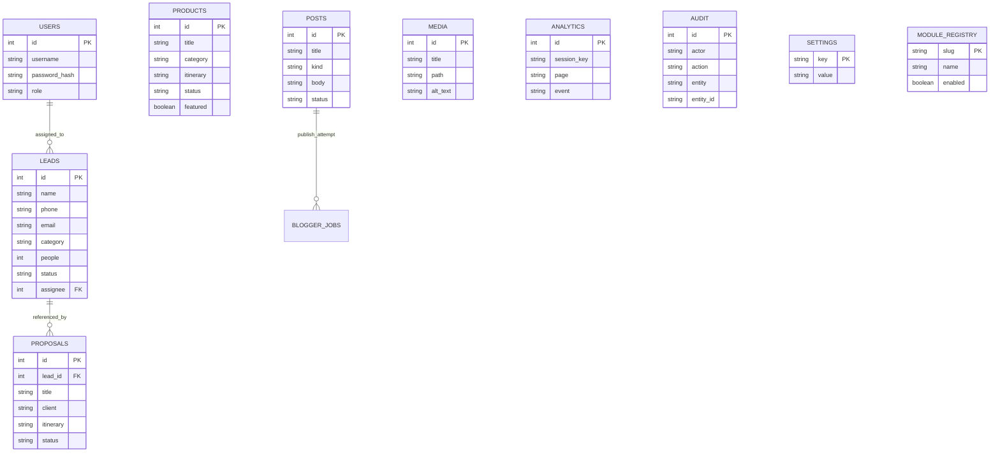

# 아키텍처 · DB · 모듈 간 연계 설계 v1.0

## 시스템

- 프론트엔드: FastAPI Server-side Templates(Jinja2), 반응형 CSS, 경량 JS. 외부 CDN에 의존하지 않음.
- Backend: REST-ish HTTP routes, FastAPI, SQLite3, scrypt password hashing, signed session, CSRF tokens, permission maps.
- Images: PIL `verify()` + pixel count/byte limits → clean RGB WebP 변환, EXIF 제거, 랜덤 파일명.
- Blogger: Google Blogger v3 posts.insert(isDraft=true) OAuth refresh token, 서버측 credentials. 공급자 인증 미설정 시 작업 실패를 로그에 남김.
- Analytics: 공개 페이지 GET 요청으로 pageview 기록; 30일 익명 쿠키 기준 세션 중복 집계 및 실제 상담 상태 데이터. 외부 GA/광고 데이터 연동 아님.
- DB: 하나의 `SQLite` 로컬 파일(가벼운 소규모 단일 인스턴스). 대규모 동시접속/다중 서버 운영 시 PostgreSQL 전환 필요.

## 핵심 데이터 엔터티

## 5대 여행 분야

`domestic`(국내여행), `benchmark`(선진지견학), `outing`(나들이), `workshop`(워크숍), `family`(가족여행).

### 데이터 흐름

1. 관리자가 `/admin/products` 에 상품과 분야를 저장 → SQLite products → 공개 `/tours`와 `/services/{category}`.
2. 방문자가 `/contact` 서명된 CSRF 포함 문의 전송 → 요청 검증·연락처 형식 검증·동의 → leads에 `new` → 운영담당자 역할 사용자에게 배정 → 견적 전달 상태 변경.
3. 필요 시 상담과 제안서를 `proposals.lead_id`로 연결합니다. 제안서를 `proposals` 저장 → 내부 `/admin/proposals/{id}/print` 인쇄용 A4 HTML 생성 → 브라우저에서 PDF 저장 → 메일로 개별 전달. 메일 직접 전송은 미연동.
4. 게시판 posts 게시 → 공개 `/board` 목록/상세 노출 → OAuth가 있을 때 Google Blogger 초안 생성 시도 → 전송 결과 `blogger_jobs` 기록.
5. 페이지 방문 events → analytics 집계 → `/admin/analytics`; 운영 데이터 수정은 audit에 기록.
6. module_registry 변경 → products/posts/leads 공개 라우트 활성/중지 반영 → 관리자 편집은 계속 접근 가능.

## 역할권한

| 역할 | 상품/게시물/이미지 | 견적 상담 | 제안서 | 통계 | Blogger | 설정/계정 |
|---|---|---|---|---|---|---|
| admin | 모두 | 읽기·수정 | 모두 | 읽기·CSV | 초안 생성 | 모두 |
| editor | 모두 | 접근 불가 | 모두 | 읽기 | 초안 생성 | 접근 불가 |
| operator | 접근 불가 | 읽기·수정·CSV | 작성·수정 | 읽기 | 접근 불가 | 접근 불가 |

## 추가 고도화 권장

- SQLite → Neon/PostgreSQL, SQLAlchemy/Alembic 마이그레이션 및 클라우드 오브젝트 스토리지(업로드 이미지).
- Celery/RQ 워커 기반 장기 비동기 작업(이메일·SMS·Blogger), idempotency key, 전송 결과 재시도.
- 견적 버전 관리 및 PDF 자동 생성, 여행상품 출발일·좌석/결제/취소 규정 등 예약 엔터티.
- 실제 개인정보 보유 기간 확정 및 만료 자동 삭제, 접근 이력 고도화, 2FA, 사용자 비활성화/퇴사자 권한 회수.
- 이미지 승인/저작권 체크, 파일 ACL, 마케팅 UTM/GA4, 동의 기반 홍보.
- CSP 강화, CSRF/알림 재시도 분리, 레이트리밋 Redis, HTTPS 프록시/보안 헤더, SAST 및 취약점 스캔.

운영 테스트 합격(로컬)과 상용 서비스 출시 승인(계약·보안·현장 검증)은 다릅니다.

## v1.1 신규 구조 (2026-10-30)

- `users.active`(0/1)와 `users.auth_version`(기본 1): `security.allowed()`가 데이터베이스의 계정 상태/현재 역할/버전을 매 요청 재확인합니다. 비밀번호 변경·관리자 중지 시 기존 브라우저 서명 세션은 무효입니다.
- `tasks(id,title,description,lead_id,assignee,due_date,priority,status,created_at,updated_at)`: 상담과 연결 가능한 업무 진행 상태를 관리합니다. 관리자/운영자/편집자가 업무를 기록하며 삭제는 최고 관리자만 수행합니다.
- `settings.privacy.lead_retention_days`: 운영자가 확정할 상담데이터 보유일수. 기본값 없음. `scripts/purge_expired.py`가 **기본 dry-run**으로 완료·종결된 상담 중 오래된 레코드를 대상으로 확인하고 `--execute` 명시시에만 삭제합니다. 무인 자동 실행은 미설치.
- `settings.system.initial_seed_done`: 전체 상품/게시물이 삭제되더라도 재부팅마다 예시 데이터를 다시 채우지 않는 초기화 마커.
- `GET /admin/blogger/preview/{id}`: 오프라인 미리보기. 실제 Blogger 서버 POST는 오직 임시글 전송 버튼으로만 호출.
- `GET /privacy`: 정식 법률 검토 전 **안내용 초안**. 실제 운영 공개 전 필수 항목 보완·확정 필요.
- 추가된 `Cache-Control: no-store`는 관리자·최초 설정 경로 응답에 적용됩니다.

### 제한 사항

단일 프로세스·로컬 SQLite·쿠키세션·메모리 레이트리밋 구조이므로 다중 노드 확장, 강제 로그아웃 전파, 트래픽 방어, 실 결제·실 예약 동시성에는 적합하지 않습니다. HTTPS 리버스 프록시, 스토리지 ACL, 자동 백업·복구 및 외부 서비스 인증은 별도 구축 필요합니다.
